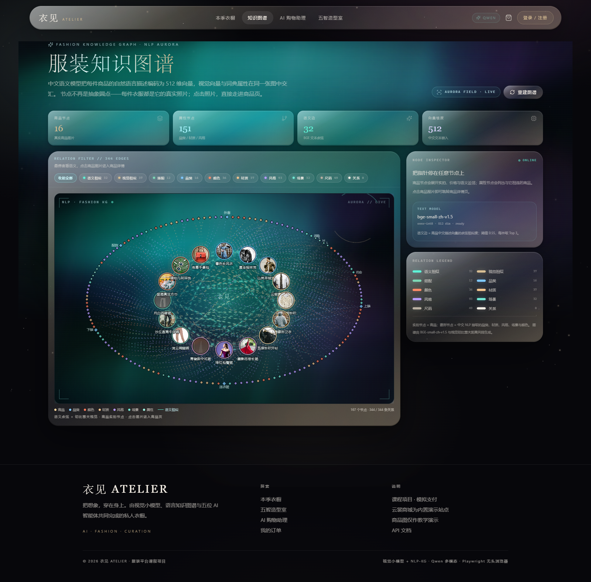

# 衣见 ATELIER · AI 服装买手店

> 课程 / 毕业设计演示项目：一个可完整运行的全栈 AI 服装电商平台。
> 五智能体看图荐衣、单智能体浏览器下单、小模型 + 大模型分层；无 `DASHSCOPE_API_KEY` 时全链路自动 Mock，开箱即跑。
> 内置的「云裳商城」是**模拟商城**，结算与支付均为模拟，不接真实电商与真实支付。

## 实测状态（2026-11-21，本机）

| 检查 | 命令 | 结果 |
|---|---|---|
| 后端测试（T18 复跑） | `backend/.venv/Scripts/python.exe -m pytest` | **79 passed**，26.83 秒 |
| 前端类型检查 + 构建（T18 复跑） | `cd frontend && npm run build` | 通过，1640 modules，约 2.76 秒 |
| 局部 HTTP 冒烟（T18 复跑） | `backend/.venv/Scripts/python.exe scripts/smoke_test.py`（后端已启动） | **10/10 通过** |
| 无 Key 全链路 E2E（T17） | `backend/.venv/Scripts/python.exe scripts/e2e_full_mock.py`（后端已启动） | **10/10 通过**，真实 Playwright + Microsoft Edge 无头下单 |
| 主代理独立验收（2026-11-22） | `backend/.venv/Scripts/python.exe scripts/acceptance_check.py`（后端已启动） | **28/28 通过**，含真实 Edge 7 步下单/截图、五智能体两轮、Chebyshev 3.0 |

> 无 Key 全链路细节、截图索引与遗留事项见 [docs/E2E_RESULTS.md](docs/E2E_RESULTS.md)。
> 主代理独立复核与演示库清理记录见 [docs/MAIN_ACCEPTANCE.md](docs/MAIN_ACCEPTANCE.md)。
> 本机未配置 DashScope Key，**有 Key 的真实 Qwen 路径未在本机验证**；下文对 Qwen 的描述来自代码实现与降级设计，不当作已通过的实测结论。

## 项目简介

衣见 ATELIER 以「深夜高定编辑部」为视觉主题，把常规服装电商能力与两类 AI 能力放在同一个站点里：

1. **AI 造型师**：用户上传一张穿搭或单品图片，系统先用视觉小模型做相似检索，再用 NLP-KG 小模型做知识图谱扩展，最后交给时尚、艺术、审美、价格、舒适度五个智能体进行两轮互评，流式返回 Top3 与整套穿搭建议。
2. **AI 购物助理**：用户说“我想买风衣”会得到带图商品链接；说“帮我下单风衣”后，后端用 Playwright 无头浏览器真实打开内置的云裳商城，完成搜索、选规格、结算与提交，逐步截图并在成功后才提示下单成功。

小模型层保留干净的 `Protocol` 与 HTTP 适配器，视觉 / NLP-KG 的 stub 是可运行的**可替换基线**；用户后续自行训练模型后，只需切换环境变量即可接入，不需要改业务代码。

## 核心功能

### 1. 基础电商

- 注册 / 登录 / 当前用户 / 登出，JWT 鉴权，scrypt 密码哈希。
- 16 件种子商品，覆盖外套、上装、连衣裙、下装、配饰 5 个品类，全部使用本地 WebP 图片。
- 商品搜索、分类筛选、价格 / 上新 / 销量排序、分页、精选商品。
- 商品详情、图集、面料 / 版型 / 颜色 / 尺码、同品类推荐、图片搜索（Shop 页“以图搜衣”）。
- 购物车增删改查、结算、模拟支付、订单列表 / 详情 / 取消。
- 内置演示账号 `demo / demo123`，首次启动自动写入商品、账号与一条历史订单。

### 2. 五智能体看图荐衣

- 上传图片（或使用样例图），可选预算与文字备注。
- Qwen-VL 解析图片属性；无 Key 或调用失败时自动切换确定性 Mock。
- 视觉小模型产出 256 维 embedding，按切比雪夫距离检索 Top-8 候选。
- NLP-KG 小模型抽取品类 / 颜色 / 材质 / 风格 / 场景，构建知识图谱并扩展搭配候选；候选去重后截断到 12 个。
- 五个固定智能体：`fashion/时尚`、`art/艺术`、`aesthetics/审美`、`price/价格`、`comfort/舒适度`。
- Round 1 独立评分；Round 2 看到彼此观点，向具名同伴发言并允许最多修订 2 个分数；聚合器不是第六个智能体。
- 全程 SSE 流式展示：视觉解析、候选、图谱、轮次、智能体消息、修订、最终整套穿搭。
- 聚合权重以代码为准：时尚 0.25、艺术 0.15、审美 0.20、价格 0.20、舒适度 0.20。

### 3. 单智能体 + 浏览器自动化

- 自然语言意图：买 / 下单 / 搜索；规则优先，Qwen 兜底结构化解析。
- 商品链接卡同时提供平台商品页与云裳商城商品页。
- 下单时由 Playwright 驱动本机 Edge（无头）打开内置云裳商城，执行搜索、详情、选规格、立即购买、填写收货信息、提交订单。
- 每一步通过 `browse_step` 推送动作、状态、详情与截图；截图位于 `backend/runtime/screenshots/<session_id>/NN.png`，通过 `/screenshots/...` 访问。
- 只有商城订单接口返回订单号、且平台数据库中确实存在该订单后才提示“下单成功”，并写入平台 `orders`（`source=agent`），可在 `/orders` 查到。
- 浏览器不可用、超时或下单失败时明确返回中文错误，**绝不假装成功**。
- 默认使用 Playwright（稳定、可复现，适合课堂演示）。**可选 browser-use 1.x 适配器已实现**：安装 `backend/requirements-optional.txt`、配置 `DASHSCOPE_API_KEY`，并设置 `BROWSER_ENGINE=browser_use` 即可切换；缺少可选包或 Key 时会明确报错（或按 `BROWSER_USE_FALLBACK_TO_PLAYWRIGHT=true` 回退 Playwright），不会伪造成功。本机当前未安装可选包、无 Key，因此该路径的真实执行未实测；默认 Playwright 路径已实测。

### 4. 小模型 + 大模型分层

- 小模型负责 embedding、相似检索、知识图谱与切比雪夫距离，确定性、可离线、可替换。
- 大模型只通过适配层消费小模型输出，负责理解、评议与中文表达；不耦合小模型内部结构。
- `SMALL_MODEL_MODE=stub|http`；HTTP 模式下可指向用户自己训练并部署的视觉 / NLP-KG 服务。
- 接入契约、JSON 示例、维度变化后的重建说明见 [docs/small-model-interface.md](docs/small-model-interface.md)。
- 知识图谱的中文语义边由本地 `BGE-small-zh-v1.5`（ONNX INT8，512 维）生成，安装与下载见 [docs/nlp-embedding-model.md](docs/nlp-embedding-model.md)。

### 5. 服装知识图谱（`/graph`）

- **商品实拍节点**：图谱不再用抽象圆点表示商品，每个商品节点直接显示真实商品图片；悬停展开价格与语义近邻，点击图片自动跳转 `/product/{id}`。
- **中文 NLP 语义边**：本地 `BGE-small-zh-v1.5`（ONNX INT8）把商品中文描述编码为 512 维向量，余弦相似度 ≥ 0.55 的商品连成 `semantic_similar` 边；与视觉 `similar_to`、搭配 `pairs_with`、品类/颜色/材质/风格/场景属性边共存。
- **极光图谱背景**：`AuroraField` 用多层 CSS 极光幕、网格、星点与扫描线构成深空极光场；语义边使用青绿流光、发光滤镜与沿线粒子，视觉/搭配边使用香槟金与鼠尾草绿。
- **关系过滤与节点检查器**：可按语义、视觉、搭配、品类、颜色、材质、风格、场景、尺码过滤边；右侧面板展示当前节点的实拍、价格、语义近邻与属性关联商品。
- 模型文件与下载方式见 [docs/nlp-embedding-model.md](docs/nlp-embedding-model.md)；模型缺失时自动跳过语义边，其余图谱照常工作。



### 6. 视觉与交互

- 深空黑 + 香槟金 + 象牙白；液态玻璃、星空画布、鼠标尾焰、噪点与光标柔光。
- 首页（5 屏）与 AI 造型页（4 屏）使用整屏竖向翻页；商品、购物车、结算、订单保持常规滚动。
- 移动端与 `prefers-reduced-motion` 自动退化为普通滚动并关闭高消耗动效。
- 所有字体、图片、图标本地化，不依赖外部 CDN / Google Fonts / 远程图片。

## 技术栈

| 层 | 技术 |
|---|---|
| 前端 | React 18、TypeScript 5、Vite 6、Tailwind CSS 3、React Router 6、Zustand 5、lucide-react |
| 后端 | Python 3.10+（本机验证 3.13.5）、FastAPI、SQLAlchemy 2、Pydantic 2、SQLite、PyJWT、httpx、python-multipart |
| 小模型 | Pillow + NumPy 的确定性视觉 stub；NLP 文本嵌入 `BGE-small-zh-v1.5`（ONNX INT8，512 维）；可切换 HTTP 远程推理服务 |
| 大模型 | 通义千问 DashScope OpenAI 兼容接口：`qwen3-vl-plus`（图片）、`qwen-plus`（文本）；无 Key 自动 Mock |
| 浏览器 | Playwright（默认本机 Edge `msedge`，无头；失败回退 Playwright 内置 Chromium）；可选 browser-use 1.x 适配器 |
| 实时流 | 后端 SSE；前端 `fetch` + `ReadableStream` 自解析，不使用 `EventSource` |
| 测试 | pytest（默认 mock 浏览器引擎）、`tsc --noEmit`、`vite build`、HTTP 冒烟与可选真实浏览器 E2E 脚本 |

## 目录结构

```text
服装平台项目/
├─ README.md
├─ docs/
│  ├─ CONTRACTS.md              # 并行开发接口契约（唯一事实来源）
│  ├─ architecture.md           # 架构与 Mermaid 图
│  ├─ demo-script.md            # 8–10 分钟答辩演示脚本
│  ├─ browser-automation.md     # 云裳商城与 Playwright 流程
│  ├─ small-model-interface.md  # 小模型接入契约
│  ├─ E2E_RESULTS.md            # 无 Key 全链路验收结果
│  ├─ MAIN_ACCEPTANCE.md        # 主代理独立复核与演示库清理记录
│  └─ screenshots/              # 页面截图与浏览器下单轨迹（长期归档）
├─ scripts/
│  ├─ setup.sh / setup.ps1      # 环境准备（不启动服务器）
│  ├─ dev.sh / dev.ps1          # 同时启动前后端，Ctrl+C 一起停止
│  ├─ build.ps1                 # 后端导入检查 + 前端生产构建
│  ├─ fetch_assets.py           # 本地商品图 / 主视觉 / 样例图生成与下载
│  ├─ smoke_test.py             # 对运行中后端的 HTTP 冒烟
│  ├─ e2e_browser_test.py       # 可选真实浏览器 E2E（默认跳过）
│  ├─ e2e_full_mock.py          # 无 Key 全链路 E2E
│  └─ acceptance_check.py       # 主代理独立验收（28 项，含真实 Edge 下单）
├─ backend/
│  ├─ requirements.txt
│  ├─ requirements-optional.txt # 可选 browser-use 引擎（默认不安装）
│  ├─ .env.example              # 环境变量模板（复制为 .env）
│  ├─ pytest.ini
│  ├─ app/
│  │  ├─ main.py config.py database.py models.py schemas.py security.py deps.py
│  │  ├─ seed.py catalog_data.py
│  │  ├─ routers/               # auth products cart orders small_models recommend assistant demo_mall
│  │  ├─ llm/                   # qwen / mock / prompts
│  │  ├─ agents/                # base / bus / personas / orchestrator
│  │  ├─ small_models/          # base / vision_stub / nlp_kg_stub / http_adapters / factory / metrics
│  │  ├─ browser/               # base / playwright_driver / shopper / mock_driver / order_service / browser_use_driver
│  │  ├─ services/              # recommendation / assistant
│  │  ├─ demo_mall/             # 云裳商城原生 HTML/CSS/JS
│  │  └─ static/images/         # products / hero / samples（本地 WebP）
│  ├─ data/app.db               # SQLite（首次启动自动创建，git 忽略）
│  ├─ runtime/                  # uploads / screenshots / 测试日志（git 忽略）
│  └─ tests/                    # 6 个测试文件，79 个用例
├─ frontend/
│  ├─ package.json vite.config.ts tailwind.config.ts tsconfig.json index.html
│  ├─ public/images/fallback/   # 本地 SVG 兜底图
│  └─ src/
│     ├─ main.tsx App.tsx
│     ├─ styles/                # tokens / glass / globals
│     ├─ lib/                   # api.ts / sse.ts / format.ts
│     ├─ store/                 # auth / cart / toast
│     ├─ components/            # ui / effects / layout / product / ai
│     ├─ pages/                 # Landing / Auth / Shop / ProductDetail / Cart / Checkout /
│     │                         # Orders / Assistant / Stylist / NotFound
│     └─ types/index.ts
└─ .gitignore
```

## 快速开始（Windows 从零启动）

### 环境要求

> 以下命令按本机项目目录 `C:/Users/cc/Desktop/服装平台项目` 编写；如果项目放在其他目录，替换为实际路径即可。

- Windows 11（本机验证 Windows 11 Home China 10.0.26200）。
- Python 3.10+；本机验证 3.13.5。若系统没有 `python` 命令，可用 `py -3`。
- Node.js 18+，推荐 Node 24；npm 随 Node 安装。前端 `.npmrc` 使用 `https://registry.npmmirror.com`。
- 可选：Microsoft Edge（浏览器下单默认使用本机 Edge）。没有 Edge 时可安装 Playwright Chromium。
- 不需要任何外部 API Key；默认 Mock 模式即可完整演示。

### 方式 A：一键脚本（推荐）

Git Bash：

```bash
cd C:/Users/cc/Desktop/服装平台项目
bash scripts/setup.sh          # 检查 Python/Node，创建 venv，安装依赖，生成 .env
bash scripts/dev.sh            # 同时启动后端 :8000 与前端 :5173；Ctrl+C 一起停止
```

PowerShell：

```powershell
cd C:\Users\cc\Desktop\服装平台项目
powershell -ExecutionPolicy Bypass -File scripts\setup.ps1
powershell -ExecutionPolicy Bypass -File scripts\dev.ps1
```

常用参数：

```bash
bash scripts/setup.sh --check          # 只检查环境，不安装、不写文件
bash scripts/setup.sh --skip-install   # 依赖已就绪时只补齐 .env
bash scripts/setup.sh --with-browser   # 额外安装 Playwright Chromium（可选）
```

```powershell
powershell -ExecutionPolicy Bypass -File scripts\setup.ps1 -Check
powershell -ExecutionPolicy Bypass -File scripts\setup.ps1 -WithBrowser
```

脚本不会启动服务器；`dev.sh` / `dev.ps1` 会在端口被占用时直接报错退出，避免和上次残留进程混用。

### 方式 B：手动启动

终端 A（后端）：

```bash
cd C:/Users/cc/Desktop/服装平台项目/backend

# 仅当 .venv 不存在时执行；已有虚拟环境可跳过
python -m venv .venv
# 或：py -3 -m venv .venv

# 安装依赖
.venv/Scripts/python.exe -m pip install -r requirements.txt

# 仅当 .env 不存在时执行（.env 已被 git 忽略）
cp .env.example .env

# 启动 API
.venv/Scripts/python.exe -m uvicorn app.main:app --host 127.0.0.1 --port 8000 --reload --reload-dir app
```

首次启动会自动建表并写入 16 件商品、演示账号 `demo / demo123` 与一条历史演示订单；同时预热视觉 embedding 与知识图谱。数据库文件为 `backend/data/app.db`。

终端 B（前端）：

```bash
cd C:/Users/cc/Desktop/服装平台项目/frontend
npm install
npm run dev
```

Vite 代理 `/api`、`/demo-mall`、`/static`、`/screenshots`、`/uploads`、`/docs`、`/openapi.json`、`/redoc` 到 `http://127.0.0.1:8000`（见 `frontend/vite.config.ts`）。

### 打开页面

| 用途 | 地址 |
|---|---|
| 前端主站 | http://127.0.0.1:5173 |
| 服装知识图谱 | http://127.0.0.1:5173/graph |
| 后端根地址 | http://127.0.0.1:8000 |
| FastAPI 交互文档 | http://127.0.0.1:8000/docs |
| OpenAPI JSON | http://127.0.0.1:8000/openapi.json |
| 健康检查 | http://127.0.0.1:8000/api/health |
| 运行模式 / 功能开关 | http://127.0.0.1:8000/api/meta |
| 云裳商城 | http://127.0.0.1:8000/demo-mall/ |

### 演示账号

- 用户名：`demo`
- 密码：`demo123`
- 昵称：云裳体验官

登录页提供「使用演示账号 demo / demo123」一键填充按钮。首次启动的种子数据还包括一条历史订单，便于直接展示订单列表。

### 生产式运行（可选）

```bash
cd C:/Users/cc/Desktop/服装平台项目/frontend
npm run build

cd C:/Users/cc/Desktop/服装平台项目/backend
.venv/Scripts/python.exe -m uvicorn app.main:app --host 127.0.0.1 --port 8000
```

构建产物在 `frontend/dist`；后端启动时若检测到该目录，会自动托管 `/assets` 并对前端路由做 SPA 回退，此时直接访问 http://127.0.0.1:8000 即可，无需 Vite。也可以直接执行 `scripts/build.ps1`（后端导入检查 + 前端构建）。

### 重置演示数据

先停止后端，删除 `backend/data/app.db`，再启动后端，即可重新建表并写入种子数据。`backend/runtime/` 下的上传与截图可一并清理：

```bash
cd C:/Users/cc/Desktop/服装平台项目
rm -f backend/data/app.db
rm -rf backend/runtime/uploads backend/runtime/screenshots
```

## Mock / Qwen 模式

### 默认：Mock 模式

`backend/.env.example`（复制为 `.env`）默认：

```dotenv
LLM_MODE=auto
DASHSCOPE_API_KEY=
QWEN_TEXT_MODEL=qwen-plus
QWEN_VL_MODEL=qwen3-vl-plus
LLM_TIMEOUT=90
```

`auto` 模式下 Key 为空即自动使用 Mock。`GET /api/meta` 实测返回：

```json
{"app_name":"衣见 ATELIER","version":"1.0.0","mode":"mock","llm_mode":"auto",
 "small_model_mode":"stub","features":{"qwen":false,"browser_automation":true,
 "multi_agent":true,"small_model_http":false}}
```

前端顶部显示 Mock 徽标。Mock 不是“假页面”：

- 五智能体评分基于图片 sha256、商品 id 与智能体 id 确定性生成，五个角色公式不同，并生成中文互评话术。
- 每个智能体阶段有约 100–300ms 延迟，SSE 过程可观察。
- 视觉解析、候选、图谱、Top3、整套穿搭、浏览器步骤与订单都会真实写入数据库 / 真实产生业务结果。

### 启用 Qwen

编辑 `backend/.env`：

```dotenv
LLM_MODE=auto
DASHSCOPE_API_KEY=你的_DashScope_Key
```

重启后端。`/api/meta` 返回 `"mode": "qwen"`，前端显示 Qwen 模式。相关配置：

- `DASHSCOPE_BASE_URL=https://dashscope.aliyuncs.com/compatible-mode/v1`
- 图片理解：`QWEN_VL_MODEL=qwen3-vl-plus`
- 文本评议：`QWEN_TEXT_MODEL=qwen-plus`
- 超时：`LLM_TIMEOUT=90` 秒
- 强制模式：`LLM_MODE=qwen` 强制尝试真实 Qwen；`LLM_MODE=mock` 强制 Mock；日常建议保持 `auto`。

**注意**：本机已配置 Key，并完成真实 Qwen 视觉解析与五智能体两轮评议实测（`/api/meta` 返回 `mode=qwen`）。`LLM_MODE=qwen` 且 Key 为空时，荐衣流会通过 SSE `warning`（`qwen_no_key`）说明并降级到 Mock，不会中断演示。

### 降级行为

- Qwen 429 / 5xx / 超时：自动重试 2 次（首次 + 2 次重试）；仍失败则降级 Mock，并通过 SSE `warning` 事件给出中文提示。400 / 401 / 403 不重试。
- Qwen 返回 JSON 解析失败：容错清洗（去除 json 代码围栏、截取首尾大括号）；仍失败则降级。
- 小模型 HTTP 服务失败：默认降级回 stub，并记录 warning；`SMALL_MODEL_FALLBACK_TO_STUB=false` 时改为中文错误。
- 浏览器不可用：明确报错，不会生成假订单。

**安全**：`.env` 已被 `.gitignore` 忽略。不要把真实 API Key 写入代码、文档、截图或提交记录。

## API 与小模型接口入口

- 交互式文档：http://127.0.0.1:8000/docs （OpenAPI：`/openapi.json`）
- 小模型接口文档：[docs/small-model-interface.md](docs/small-model-interface.md)
- 小模型代码目录：`backend/app/small_models/`
- 后端冒烟脚本：`scripts/smoke_test.py`

### 主要 API

| 分组 | 方法与路径 |
|---|---|
| 系统 | `GET /api/health`、`GET /api/meta` |
| 认证 | `POST /api/auth/register`、`POST /api/auth/login`、`GET /api/auth/me`、`POST /api/auth/logout` |
| 商品 | `GET /api/products`、`GET /api/products/categories`、`GET /api/products/{id}`、`POST /api/products/search-by-image` |
| 购物车 | `GET/POST /api/cart`、`PATCH/DELETE /api/cart/{item_id}`、`DELETE /api/cart` |
| 订单 | `POST/GET /api/orders`、`GET /api/orders/{id}`、`POST /api/orders/{id}/cancel` |
| 小模型 | `GET /api/small-models/status`、`POST /api/small-models/vision/embed`、`POST /api/small-models/vision/similar`、`POST /api/small-models/kg/chebyshev`、`POST /api/small-models/kg/query`、`GET /api/small-models/kg/graph` |
| 五智能体 | `POST /api/recommend/image`（SSE）、`GET /api/recommend/sessions/{id}`、`GET /api/recommend/history` |
| 购物助理 | `POST /api/assistant/chat`（SSE）、`GET /api/assistant/sessions/{id}`、`GET /api/assistant/history` |
| 云裳商城 | 页面 `/demo-mall/`、`/demo-mall/product.html?id=`、`/demo-mall/checkout.html`、`/demo-mall/success.html?order_no=`；API `GET /demo-mall/api/products`、`GET /demo-mall/api/products/{id}`、`POST /demo-mall/api/orders` |

### 小模型接口

| 方法 | 路径 | 说明 |
|---|---|---|
| GET | `/api/small-models/status` | 当前后端、模型版本、维度、模式与预热状态 |
| POST | `/api/small-models/vision/embed` | multipart `file`，返回图片 embedding |
| POST | `/api/small-models/vision/similar` | multipart `file` + `top_k`，按切比雪夫距离返回相似商品 |
| POST | `/api/small-models/kg/chebyshev` | `{a:[...], b:[...]}`，返回距离与相似度 |
| POST | `/api/small-models/kg/query` | `{text, top_k}`，返回三元组、相关商品、扩展词 |
| GET | `/api/small-models/kg/graph` | 知识图谱节点与边，可传 `product_id`、`limit` |

切比雪夫距离与相似度：

```text
distance = max_i |a_i - b_i|
similarity = 1 / (1 + distance)
```

Stub 基线（明确标注 REPLACEABLE BASELINE）：

- 视觉：Pillow 64×64，RGB/HSV 直方图 + 梯度方向 + 分块颜色矩，L2 归一化到 256 维；确定性；启动时计算商品 embedding 并写入 `embeddings` 表。
- NLP-KG：中文词典抽取品类 / 颜色 / 材质 / 风格 / 场景 / 尺码；视觉 embedding 的 Top-3 切比雪夫近邻建 `similar_to` 边；属性边与上装↔下装搭配边用于整套推荐。

接入用户自训练模型（推荐方式）：

```dotenv
SMALL_MODEL_MODE=http
VISION_SERVICE_URL=http://127.0.0.1:9001
NLP_KG_SERVICE_URL=http://127.0.0.1:9002
SMALL_MODEL_TIMEOUT=30
SMALL_MODEL_TOKEN=
SMALL_MODEL_FALLBACK_TO_STUB=true

# 本地中文文本嵌入（知识图谱语义边）
NLP_EMBEDDING_ENABLED=true
NLP_EMBEDDING_MODEL_DIR=models/nlp/bge-small-zh-v1.5
NLP_EMBEDDING_MODEL_FILE=model_int8.onnx
NLP_SEMANTIC_TOP_K=3
NLP_SEMANTIC_THRESHOLD=0.55
```

如果模型维度变化，需要重建 `embeddings` 表；详见 [docs/small-model-interface.md](docs/small-model-interface.md)。

## 浏览器演示说明

入口：登录后访问 `/assistant`（AI 购物助理）。

示例对话：

1. 输入 **“我想买风衣”**：返回带图商品链接卡，同时给出平台商品页与云裳商城商品页。
2. 输入 **“帮我下单风衣”**：后端启动 Playwright 无头浏览器，在云裳商城完成搜索 → 详情 → 选规格 → 立即购买 → 填写收货信息 → 提交订单；前端逐步显示步骤、状态与截图。
3. 成功页读取订单号后，SSE 推送 `order_created`；平台订单写入数据库（`source=agent`），在 `/orders` 可查。

相关细节：

- 商城页面：`/demo-mall/`、`/demo-mall/product.html?id=`、`/demo-mall/checkout.html`、`/demo-mall/success.html?order_no=`。
- 截图目录：`backend/runtime/screenshots/<session_id>/01.png … 07.png`（失败时尽力生成 `99-error.png`）；访问前缀 `/screenshots/...`。截图失败不会中断下单流程，`browse_step.screenshot` 会是 `null`。
- 浏览器：`BROWSER_ENGINE=playwright`、`BROWSER_HEADLESS=true`、`PLAYWRIGHT_CHANNEL=msedge`；视口 1280×900，语言 `zh-CN`，默认操作超时 15 秒、导航超时 25 秒；同一时刻只允许一个浏览器任务。
- 浏览器启动顺序：先尝试本机 Edge（`channel=msedge`），失败后尝试 Playwright 内置 Chromium；两者都失败才以中文错误终止，不伪造订单。
- 本机已验证：Microsoft Edge 157.0.4341.60，真实浏览器完成 7 个步骤并落库 `source=agent` 订单 `YJ202611212346510445`；截图见 `docs/screenshots/t17/assistant-order/01.png … 07.png`。
- 完整流程、稳定选择器与限制见 [docs/browser-automation.md](docs/browser-automation.md)。

**合规边界**：云裳商城是项目内置的模拟商城；浏览器自动化只在本地模拟商城内操作，不登录真实电商、不抓取真实平台、不进行真实支付。

## 测试与自检

后端（Mock 模式，无需 Key；默认 mock 浏览器引擎，不会启动真实浏览器）：

```bash
cd C:/Users/cc/Desktop/服装平台项目/backend
.venv/Scripts/python.exe -m pytest
```

本次实测：**79 passed, 26.83s**（2026-11-21）。仅有 Starlette/httpx 弃用提示与 PyJWT 默认密钥长度告警，均不影响测试结果。

前端类型检查与构建：

```bash
cd C:/Users/cc/Desktop/服装平台项目/frontend
npm run typecheck
npm run build
```

本次实测：类型检查通过，Vite 构建 1640 modules，约 2.76 秒（2026-11-21）。

HTTP 冒烟（需要后端已在 8000 端口运行；脚本只使用标准库）：

```bash
cd C:/Users/cc/Desktop/服装平台项目
backend/.venv/Scripts/python.exe scripts/smoke_test.py
```

本次实测：**10/10 通过**。脚本会注册一次性冒烟账号，并创建、取消一笔演示订单，请勿在需要保留订单数据时运行。

可选真实浏览器 E2E（默认跳过，以 0 退出）：

```bash
cd C:/Users/cc/Desktop/服装平台项目
backend/.venv/Scripts/python.exe scripts/e2e_browser_test.py            # 默认跳过
backend/.venv/Scripts/python.exe scripts/e2e_browser_test.py --browser  # 真实 Edge/Chromium
backend/.venv/Scripts/python.exe scripts/e2e_browser_test.py --browser --headed  # 可见窗口
```

无 Key 全链路 E2E（需后端运行；会清空 demo 购物车并留下测试数据）：

```bash
cd C:/Users/cc/Desktop/服装平台项目
backend/.venv/Scripts/python.exe scripts/e2e_full_mock.py
```

T17 实测：**10/10 通过**，真实浏览器下单并可从 `/api/orders` 查到 `source=agent`。详见 [docs/E2E_RESULTS.md](docs/E2E_RESULTS.md)。

> 仓库当前没有 `RUN_BROWSER_TESTS` 这个 pytest 开关；真实浏览器验证请使用上述独立脚本。默认 `pytest` 用 Mock 引擎覆盖完整个购物助理链路，不依赖 Edge。

## 常见问题与故障排查

**环境检查不通过？**

```bash
cd C:/Users/cc/Desktop/服装平台项目
bash scripts/setup.sh --check
```

按提示检查 Python 3.10+、Node 18+、`backend/.env` 与前端依赖。

**PowerShell 提示脚本被禁止运行？**

使用 README 中的 `powershell -ExecutionPolicy Bypass -File ...` 方式执行；或在当前会话临时执行 `Set-ExecutionPolicy -Scope Process Bypass`。

**pip 安装慢或失败？**

先确认网络可用；国内网络可临时使用阿里云 PyPI 镜像：

```bash
cd C:/Users/cc/Desktop/服装平台项目/backend
.venv/Scripts/python.exe -m pip install -r requirements.txt -i https://mirrors.aliyun.com/pypi/simple/
```

前端依赖已通过 `frontend/.npmrc` 使用 `https://registry.npmmirror.com`；如仍失败，检查代理与 npm 配置。

**打开 8000 端口看到 JSON 而不是页面？**

开发模式请访问 `http://127.0.0.1:5173`；或者先执行 `npm run build`，让后端托管 `frontend/dist`。未构建时后端根路径会返回说明 JSON，这是预期行为。

**端口被占用？**

`dev.sh` / `dev.ps1` 会检测 8000 与 5173 并报错。先停止占用进程（例如上次未退出的 uvicorn / Vite），再重新启动；不要只改端口而不改 Vite 代理，避免接口与截图地址漂移。

**接口返回 401？**

需要登录，或 token 已过期（默认 7 天）。重新登录即可；前端遇到 401 会清除本地 token 并跳转登录页。

**没有 DashScope Key 能演示吗？**

可以。默认 Mock 模式覆盖荐衣、互评、聚合、浏览器下单全链路，`/api/meta` 显示 `mode=mock`。前端会在顶部显示 Mock 徽标。

**浏览器下单报错？**

确认本机有 Microsoft Edge；或安装 Playwright Chromium：

```bash
cd C:/Users/cc/Desktop/服装平台项目/backend
.venv/Scripts/python.exe -m playwright install chromium
```

调试时可临时设 `BROWSER_HEADLESS=false` 观察浏览器；也可直接运行 `scripts/e2e_browser_test.py --browser --headed`。失败时前端会显示中文错误，平台不会生成订单。

**截图 404 / 看不到步骤图？**

开发模式确认 Vite 代理包含 `/screenshots`；直接访问 `http://127.0.0.1:8000/screenshots/<session_id>/01.png` 可验证。截图在 `backend/runtime/screenshots/`，该目录被 git 忽略；换机器后旧会话截图不会保留。

**商品图片缺失？**

执行本地素材脚本（优先生成离线兜底图，再尝试下载并转 WebP）：

```bash
cd C:/Users/cc/Desktop/服装平台项目
backend/.venv/Scripts/python.exe scripts/fetch_assets.py
```

**如何重置演示数据？**

停止后端，删除 `backend/data/app.db`，重启后端；如需要也可清理 `backend/runtime/uploads` 与 `backend/runtime/screenshots`。

**切比雪夫接口示例返回什么？**

```bash
curl -s -X POST http://127.0.0.1:8000/api/small-models/kg/chebyshev \
  -H "Content-Type: application/json" \
  -d '{"a":[0.1,0.2,0.3],"b":[0.4,0.1,0.2]}'
```

距离为 `0.3`，相似度为 `0.769231`（`1 / (1 + 0.3)`）。

**小模型 HTTP 服务连不上？**

默认 `SMALL_MODEL_FALLBACK_TO_STUB=true` 会降级回 stub 并在 `/api/small-models/status` / 日志中标记；若希望失败即报错，设为 `false` 后重启。修改模型维度后需重建 embedding。

## 已知限制

- 本项目是**课程 / 毕业设计演示项目**，不是生产级电商系统。
- 云裳商城是内置的**模拟商城**；支付为**模拟支付**，不会产生真实交易、真实物流或真实账号。
- 不接入真实支付渠道，不接入真实电商平台账号，不抓取真实电商数据。
- 无 Key 时使用确定性 Mock，输出质量与真实 Qwen 不同；有 Key 时依赖 DashScope 的网络与配额，服务异常会自动降级。**本机未验证真实 Qwen 路径。**
- 小模型仅为可运行的 stub 基线，未进行训练；用户可自行训练并通过 HTTP 接口替换。
- 默认浏览器引擎是 Playwright；可选 `browser_use` 适配器位于 `backend/app/browser/browser_use_driver.py`，依赖不在默认 `requirements.txt` 中。启用方式：
  ```bash
  backend/.venv/Scripts/python.exe -m pip install -r backend/requirements-optional.txt
  # backend/.env: DASHSCOPE_API_KEY=...; BROWSER_ENGINE=browser_use
  ```
  browser-use 1.0 需要文本大模型驱动；本机未安装可选包、无 Key，真实执行未验证。缺少依赖/Key 时接口返回中文错误，或按 `BROWSER_USE_FALLBACK_TO_PLAYWRIGHT=true` 回退 Playwright。browser-use 1.0 不提供逐步截图，适配器会输出动作步骤并从 `BrowseTask` 读取订单号；截图能力以默认 Playwright 引擎为准。
- 本机未安装 Playwright 内置 Chromium，浏览器下单实际使用系统 Edge；若 Edge 缺失，需要手动安装 Chromium。
- `JWT_SECRET` 默认值 `dev-change-me-please` 仅 20 字节，演示可接受；正式部署应改为 32 字节以上随机值。
- JWT 存储于 `localStorage`（演示可用，生产需考虑 XSS 风险并使用 HttpOnly Cookie 等方案）。
- SQLite 单文件数据库、浏览器并发限制为 1，适合单机演示，不适合高并发生产。
- 运行期上传与截图在 `backend/runtime/`，数据库在 `backend/data/`，均已被 git 忽略；仓库中的 `docs/screenshots/` 是长期归档截图。
- T17 全链路 E2E 在 `backend/data/app.db` 留下了一次性账号、demo 用户的两笔订单、荐衣/助理会话与浏览任务；`e2e_full_mock.py` 还会清空 demo 购物车。T18 文档验收复跑了 `smoke_test.py`，又留下一个一次性冒烟账号和一笔已取消订单。需要干净演示数据时请按“重置演示数据”处理。
- `scripts/smoke_test.py` 与 `scripts/e2e_full_mock.py` 都要求后端已运行，不会自行启动/停止服务；`e2e_browser_test.py` 需要通过本地数据库创建浏览任务令牌。
- 所有素材本地化，运行时不依赖外部 CDN / Google Fonts / 远程图片。

## 文档索引

| 文档 | 内容 |
|---|---|
| [docs/CONTRACTS.md](docs/CONTRACTS.md) | 并行开发接口契约、SSE 事件、文件归属、验收标准 |
| [docs/architecture.md](docs/architecture.md) | Mermaid 架构图、五智能体时序、小模型 / 大模型分层、SSE 流程、实测记录 |
| [docs/demo-script.md](docs/demo-script.md) | 8–10 分钟答辩演示脚本、截图点位与故障话术 |
| [docs/browser-automation.md](docs/browser-automation.md) | 云裳商城、Playwright 流程、稳定选择器、截图、失败边界 |
| [docs/small-model-interface.md](docs/small-model-interface.md) | 小模型 Python / HTTP 契约、JSON 示例、替换步骤 |
| [docs/E2E_RESULTS.md](docs/E2E_RESULTS.md) | 无 Key 全链路验收结果与浏览器下单证据 |
| [docs/screenshots/](docs/screenshots/) | 页面截图与 T17 浏览器下单轨迹 |
