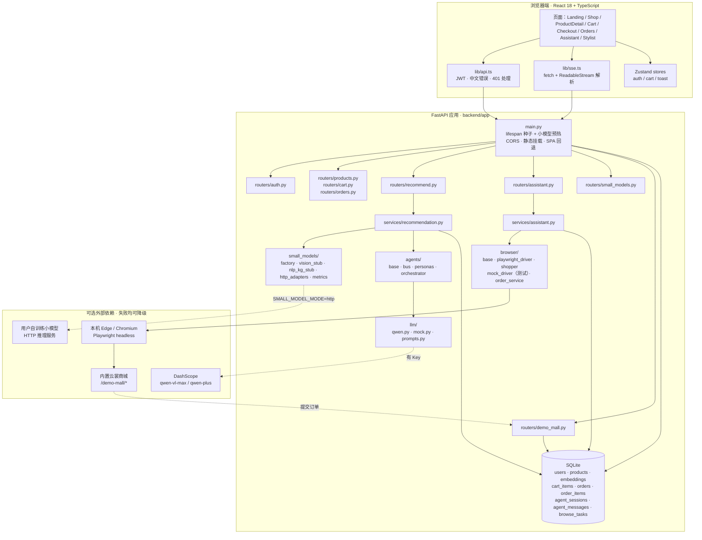
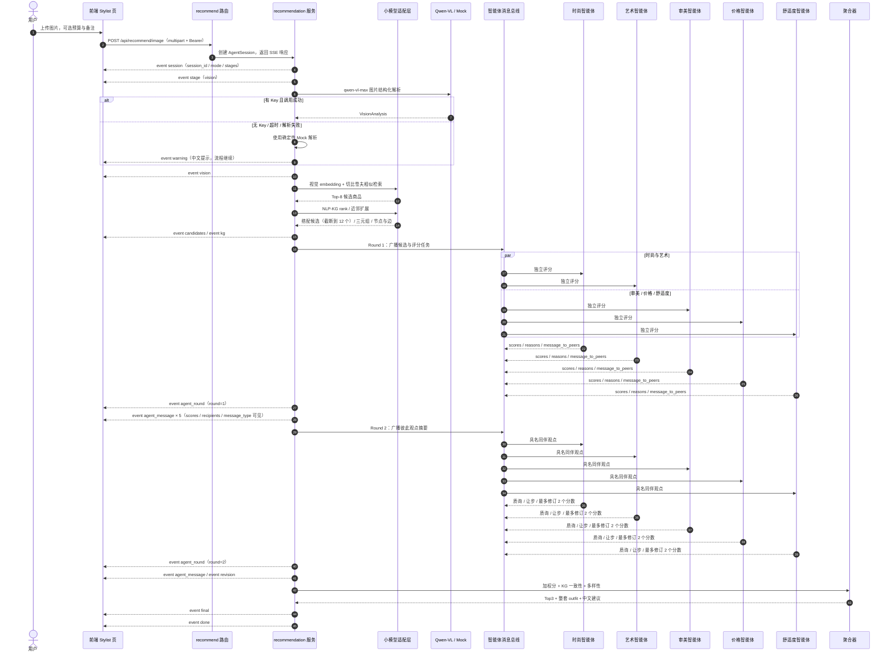
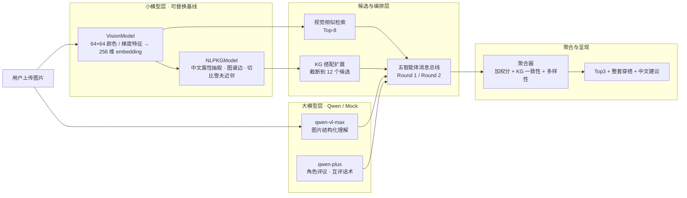
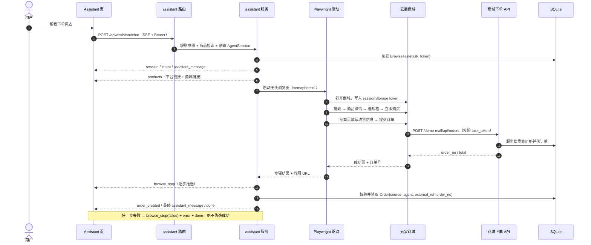

# 衣见 ATELIER 架构说明

> 事实来源：`docs/CONTRACTS.md`、仓库实际代码、`docs/E2E_RESULTS.md` 与 T17/T18 实测记录。
> 本文描述**已实现的架构**，不再使用“目标架构”表述。端口固定为前端 5173、后端 8000。
> 最近更新：2026-11-21（T18 文档定稿）。

## 1. 设计原则

1. **契约先行**：前后端、模型适配器、浏览器自动化都按 `docs/CONTRACTS.md` 的接口开发，路由前缀、SSE 事件名、字段名保持稳定。
2. **小模型先行，大模型增强**：视觉小模型负责 embedding 与候选检索，NLP-KG 小模型负责图谱扩展与切比雪夫距离；大模型负责理解、评议与表达。业务只依赖适配层，不耦合模型内部。
3. **无 Key 可完整运行**：`LLM_MODE=auto` 且 Key 为空时自动 Mock；Mock 仍走真实的数据库、SSE、订单与浏览器流程，只是模型输出是确定性的。
4. **故障可降级、结果不造假**：Qwen 失败降级 Mock 并推送 `warning`；小模型 HTTP 失败默认回退 stub；浏览器下单失败返回中文 `error`，未拿到商城订单号且平台未落库时绝不提示成功。
5. **本地自给自足**：商品图、字体、图标、样例图均在仓库内，运行时不依赖外部 CDN；浏览器只操作内置的模拟商城。
6. **测试与演示分离**：默认 `pytest` 使用 mock 浏览器引擎；真实浏览器验证使用独立脚本，避免无浏览器环境阻塞基础测试。

## 2. 总体架构



### 2.1 分层职责

| 层 | 组件 | 实际职责 |
|---|---|---|
| 表现层 | React 页面、玻璃组件、动效、`PageDeck` | 商品 / 购物流程、AI 会话控制台、SSE 事件可视化、截图时间线、KG 图 |
| API 层 | `routers/*` | 鉴权、参数校验、中文错误、SSE 响应、静态资源与 SPA 回退 |
| 业务服务层 | `services/recommendation.py`、`services/assistant.py`、`seed.py` | 编排荐衣 / 下单流程、持久化会话与订单、降级策略 |
| 智能体层 | `agents/orchestrator.py`、`bus.py`、`personas.py` | 五角色 Round 1 / Round 2、互评消息路由、修订上限、聚合 |
| 模型适配层 | `llm/*`、`small_models/*` | Qwen / Mock 切换；视觉与 NLP-KG 的 stub / HTTP 适配 |
| 浏览器层 | `browser/playwright_driver.py`、`shopper.py`、`mock_driver.py`、`order_service.py` | 浏览器启动与释放、云裳商城操作、稳定选择器、截图、测试引擎、订单落库 |
| 数据层 | SQLAlchemy 2 + SQLite | 用户、商品、向量、购物车、订单、智能体会话、浏览任务 |

### 2.2 开发与生产式拓扑

```text
开发模式：
  浏览器 → Vite :5173 ──代理 /api /demo-mall /static /screenshots /uploads
                        /docs /openapi.json /redoc──→ FastAPI :8000
                                                         ├─ SQLite backend/data/app.db
                                                         ├─ runtime/uploads  → /uploads
                                                         └─ runtime/screenshots → /screenshots

生产式：
  浏览器 → FastAPI :8000（检测到 frontend/dist 后托管 /assets + SPA 回退）
```

`main.py` 在加入路由后依次挂载 `/static`、`/screenshots`、`/uploads`、`/demo-mall`，最后注册 SPA 回退；`/api/*`、`/docs`、`/openapi.json`、`/redoc` 不会被回退吞掉。运行期文件放在 `backend/runtime/`，避免 uvicorn 监听 `app/` 时因截图写入触发热重载。

`main.py` 的 lifespan 在启动时执行 `init_db()` → `seed_if_empty()` → `small_models.factory.warm_up()`；关闭时调用 `shutdown_browser()` 关闭残留浏览器。种子或预热失败只记录日志，不阻塞应用启动。

## 3. 五智能体荐衣时序

固定五个智能体（id / 名称）：

| id | 名称 | 关注点 | 聚合权重 |
|---|---|---|---|
| `fashion` | 时尚智能体 | 当季趋势、廓形、场合匹配、品类完整度 | 0.25 |
| `art` | 艺术智能体 | 色彩关系、印花 / 肌理、视觉语言、艺术性 | 0.15 |
| `aesthetics` | 审美智能体 | 整体造型、比例、肤色 / 身形适配、高级感 | 0.20 |
| `price` | 价格智能体 | 预算、性价比、每次穿着成本、替代款 | 0.20 |
| `comfort` | 舒适度智能体 | 面料、透气、弹性、版型、护理、亲肤 | 0.20 |

聚合器不是第六个智能体，只做加权分 + KG 一致性 + 多样性校验，并输出 Top3、整套穿搭与中文建议。



关键事实：

- Round 1 五个智能体独立评分，不共享彼此结果；每个 `agent_message` 带 `scores`、`recipients`、`message_type`。
- Round 2 必须看到彼此观点，并向具名同伴发言；每个智能体最多修订 2 个商品分数，修订通过 `revision` 事件可见。E2E 实测两轮各 5 条消息、10 条 revision。
- 候选来自视觉 Top-8 + NLP-KG 近邻扩展，并自动补齐外套 / 上装 / 下装（或连衣裙）与配饰，最终截断到 12 个；T17 实测样例图产生 11 个候选。
- `final` 事件的数据结构为 `RecommendationFinal`：`session_id / mode / vision / candidates / recommendations（Top3，含 score、reasons、agent_scores）/ outfit / outfit_total / advice / kg / elapsed_ms`。
- Qwen 失败不阻塞流程：该阶段降级 Mock 或规则，并通过 `warning` 标注原因；聚合阶段的未预期异常会以 `error` + `done` 结束并记录日志，不返回伪造结果。

## 4. 小模型 + 大模型分层



### 4.1 小模型层

| 能力 | stub 基线 | 生产替换 |
|---|---|---|
| 视觉 embedding | Pillow 64×64；RGB/HSV 直方图 + 梯度方向 + 分块颜色矩；L2 归一化到 256 维；确定性 | 实现 `VisionModel` Protocol，或 `SMALL_MODEL_MODE=http` 指向 `/embed` |
| 相似检索 | 切比雪夫距离（各维差值的最大值），距离升序 | 远程服务 `/rank`，可返回 `matches` 与 `extracted` |
| NLP-KG | 中文词典抽取品类 / 颜色 / 材质 / 风格 / 场景 / 尺码；Top-3 近邻建 `similar_to` 边；属性边；上装↔下装搭配边 | 实现 `NLPKGModel` Protocol，或 HTTP `/extract`、`/rank` |
| 图谱 | `nodes` + `edges`，边权来自切比雪夫距离 | 远程服务返回同构 JSON |
| 距离接口 | `chebyshev_distance` / `chebyshev_similarity` | 同一公式，供 KG 边权与检索共用 |

小模型输出只通过适配层进入业务：

- 视觉模型：`embed` / `embed_many` / `info`。
- NLP-KG 模型：`extract` / `rank` / `neighbors` / `build_graph` / `chebyshev` / `info`。
- `factory.py` 统一 `get_vision_model()`、`get_nlp_kg_model()`、`warm_up()`、`ensure_graph()`、`rebuild_graph()`；HTTP 失败默认回退 stub 并记录 warning。
- 启动预热会补算缺失 / 维度不符 / 版本不符的 embedding 并写入 `embeddings` 表，再构建内存知识图谱。T17 启动日志实测：商品 16、embedding 16、节点 167、边 312。

**环境变量**（`backend/.env`）：

```dotenv
SMALL_MODEL_MODE=stub          # stub | http
VISION_SERVICE_URL=
NLP_KG_SERVICE_URL=
SMALL_MODEL_TIMEOUT=30
SMALL_MODEL_TOKEN=              # 可选 Bearer Token，不写日志
SMALL_MODEL_FALLBACK_TO_STUB=true
```

**维度变化**：`embeddings.dim` 与 `model_version` 会随模型变化；切换模型后必须重建 `embeddings` 表，否则旧向量与查询向量不可比。具体步骤见 `docs/small-model-interface.md`。

### 4.2 大模型层

- `llm/qwen.py`：httpx 调用 DashScope OpenAI 兼容接口；图片用 `qwen-vl-max`，文本用 `qwen-plus`；默认超时 90 秒。
- 重试：429 / 5xx / 超时自动重试 2 次（首次 + 2 次重试，间隔 1.2s、2.4s；有 `Retry-After` 时最多 5 秒）；400 / 401 / 403 不重试。
- JSON 解析容错：去除 json 代码围栏、截取首尾大括号；仍失败则降级。
- `llm/mock.py`：基于图片 sha256 与商品 id / 智能体 id 生成确定性评分与中文互评话术；五个智能体公式不同；每个智能体阶段约 100–300ms 延迟模拟流式节奏。
- `llm/prompts.py`：五角色人设、Round 1 / Round 2 模板、聚合器提示。
- 大模型只消费小模型候选、图谱摘要与商品结构，不直接读取 `embeddings` 内部或改动模型实现。

## 5. SSE 流式协议

### 5.1 响应约定

- `Content-Type: text/event-stream; charset=utf-8`
- `Cache-Control: no-cache, no-transform`
- `X-Accel-Buffering: no`
- 每 15 秒发送注释心跳 `: ping`
- 事件格式：`id: <递增>`、`event: <名称>`、`data: <JSON>`，事件之间空行分隔
- 错误使用 `error`（终止）与 `warning`（可继续）区分；业务错误文案为中文

### 5.2 荐衣事件（`POST /api/recommend/image`）

| event | 主要 data | 说明 |
|---|---|---|
| `session` | `{session_id, mode, stages}` | 会话建立；`mode` 为 `mock` 或 `qwen` |
| `stage` | `{stage, label, progress}` | 实际阶段：`vision` / `retrieval` / `round1` / `round2` / `aggregate` |
| `vision` | `VisionAnalysis` | 图片结构化属性 |
| `candidates` | `{items: ProductOut[], metric, backend}` | 视觉检索候选，`metric="chebyshev"` |
| `kg` | `{nodes, edges, metric, summary}` | 知识图谱摘要 |
| `agent_round` | `{round: 1 或 2, label}` | 轮次开始 |
| `agent_message` | `AgentMessageOut` + `agent_name` | 含 `scores` / `recipients` / `message_type` |
| `revision` | `{agent, product_id, old_score, new_score, reason}` | 分数修订 |
| `final` | `RecommendationFinal` | Top3 + outfit + advice + kg + mode + elapsed_ms |
| `warning` | `{code, message, stage}` | 可恢复降级，流程继续 |
| `error` | `{code, message}` | 终止错误（如 `no_candidates`） |
| `done` | `{session_id, elapsed_ms}` | 正常或失败流程结束 |

### 5.3 购物助理事件（`POST /api/assistant/chat`）

实际事件顺序：

- 正常搜索 / 推荐：`session` → `intent` → `assistant_message` → `products` →（可选 `warning`）→ `done`
- 下单成功：`session` → `intent` → `assistant_message` → `products` → `browse_step` × N → `order_created` → `assistant_message`（最终回复）→ `done`
- 下单失败：`...` → `browse_step`（最后一步 `status="failed"`）→ `error` → `done`（`done.status="failed"`）

| event | 主要 data | 说明 |
|---|---|---|
| `session` | `{session_id, kind, mode, engine}` | 建立 assistant 会话 |
| `intent` | `{intent, query, size, color, confidence}` | 意图结构 |
| `assistant_message` | `{role, content}` | 助理回复（下单成功后会再发一条最终回复） |
| `products` | `{items:[{product, platform_url, mall_url}]}` | 带图商品链接卡 |
| `browse_step` | `{index, action, status, detail, screenshot}` | 浏览器每一步与截图 URL |
| `order_created` | `{order_no, source, total, session_id}` | 只有在商城订单号与平台订单都确认后才发送 |
| `warning` | `{code, message, stage?}` | 非终止提示（如 `variant_adjusted`、`no_product`、`qwen_fallback`） |
| `error` | `{code, message}` | 浏览器不可用 / 下单失败，终止 |
| `done` | `{session_id, elapsed_ms, status}` | 流程结束；失败时 `status="failed"` |

### 5.4 前端消费（`src/lib/sse.ts`）

- 使用 `fetch` + `ReadableStream`，以便携带 `Authorization: Bearer`；不使用 `EventSource`。
- 支持 `FormData`（上传图片）与 JSON（聊天）两种请求体。
- 按空行切分事件块，跨 chunk 缓冲；`data` 多行拼接后尝试 `JSON.parse`。
- 401 时清除本地 token 并跳转登录。
- 使用 `AbortController` 支持用户主动取消；取消不视为错误。
- 助手页只有在收到 `order_created` 后才显示“下单成功”和订单号；中间步骤不算成功。

### 5.5 服务端生命周期

- 在阶段边界写数据库（会话状态、智能体消息、候选、最终结果、浏览步骤、订单）。
- 荐衣流在视觉 / 候选阶段即写入部分结果，即使随后断开也能回看。
- 购物助理把浏览器任务放入后台任务执行；客户端断开只停止消费队列，任务仍尽量完成落库。
- 对外统一转成中文 `error` / `warning` 事件，同时记录日志。
- 会话可通过 `GET /api/recommend/sessions/{id}` 或 `GET /api/assistant/sessions/{id}` 回看，刷新页面不丢失。

## 6. 单智能体浏览器链路



### 6.1 浏览器引擎实际行为

- 默认 `BROWSER_ENGINE=playwright`。`build_shopper()` 只把 `mock` 识别为测试引擎，其他值一律使用 `MallShopper`（Playwright）；仓库**没有** browser-use 适配器。
- `PlaywrightDriver` 先尝试 `chromium.launch(channel="msedge", headless=True)`；Edge 失败后尝试 Playwright 内置 Chromium；两者都失败抛 `BrowserUnavailable`（中文消息）。
- 视口 1280×900，语言 `zh-CN`；默认操作超时 15 秒，导航超时 25 秒；`asyncio.Semaphore(1)` 保证同一时刻只有一个浏览器任务。
- 截图写入 `backend/runtime/screenshots/<session_id>/NN.png`，成功步骤为 `01.png`…`07.png`，失败时尽力生成 `99-error.png`；截图失败返回空 URL，不中断流程。
- 浏览器在每次任务结束后关闭；应用 lifespan 关闭时兜底调用 `shutdown_browser()`。

### 6.2 云裳商城下单与订单落库

- 商城 API：`GET /demo-mall/api/products?q=`、`GET /demo-mall/api/products/{id}`、`POST /demo-mall/api/orders`。
- 下单入参包含 `task_token`、`product_id`、`size`、`color`、`quantity`、`customer`；服务端校验 `BrowseTask` 令牌与所属会话用户。
- 服务端根据商品库重新计算金额，校验库存、尺码、颜色（数量 1–10），不信任前端传入的价格。
- 创建 `Order(source="agent", status="paid", external_ref=order_no)` 与订单快照；`external_ref` 唯一，同一 `task_token` 重复提交幂等返回原订单。
- 助理服务拿到成功页订单号后还会执行 `_verify_order(order_no, user_id)`；平台查不到订单时按失败处理，不发送 `order_created`。

详细步骤、稳定选择器、截图目录与测试方式见 `docs/browser-automation.md`。

## 7. 数据模型

| 表 | 关键字段 | 用途 |
|---|---|---|
| `users` | id、username(unique)、password_hash、nickname、created_at | 账号；密码 scrypt |
| `products` | sku(unique)、name、category、price、original_price、description、fabric、fit、style_tags、colors、sizes、image、gallery、stock、rating、sales、search_text、occasion、season、comfort、featured | 16 件种子商品 |
| `embeddings` | product_id(PK/FK)、vector(JSON)、dim、model_version、updated_at | 视觉小模型商品向量 |
| `cart_items` | user_id、product_id、quantity、size、color，唯一约束 `(user_id, product_id, size, color)` | 购物车 |
| `orders` | order_no(unique)、user_id、status、source、total、shipping_*、external_ref(unique)、agent_session_id、created_at | 平台 / 智能体订单；`source` 为 `platform` 或 `agent` |
| `order_items` | order_id、product_id、name、image、price、quantity、size、color | 订单快照 |
| `agent_sessions` | id(UUID hex)、user_id、kind、input_image、status、mode、error、result、时间戳 | 荐衣 / 助理会话 |
| `agent_messages` | session_id、seq、agent、round、role、message_type、recipients、content、payload、scores | 五智能体圆桌记录 |
| `browse_tasks` | session_id、task_token(unique)、status、steps、order_no、error | 浏览器下单任务与步骤 |

- 数据库默认 `sqlite:///./data/app.db`，相对路径由 `config.py` 解析到 `backend/data/`，不依赖 shell 当前目录。
- 订单号格式：`YJ{YYYYMMDDHHMMSS}{4 位随机}`。
- 订单状态：模拟支付成功后为 `paid`；取消后为 `cancelled`。
- `external_ref` 唯一，用于把商城订单号与平台订单一一对应。
- 上传图片保存到 `backend/runtime/uploads/`；商品图在 `backend/app/static/images/products/`。

## 8. 安全、降级与边界

### 8.1 安全

- 密码：`hashlib.scrypt`，不引入 bcrypt / passlib，避免 Windows + Python 3.13 安装问题。
- JWT：PyJWT HS256，默认 7 天（10080 分钟）；前端存 `localStorage["yijian_token"]`，演示可接受，生产应改为 HttpOnly Cookie 等方案。
- CORS 白名单来自 `CORS_ORIGINS`；默认包含 5173 与 8000 的 localhost / 127.0.0.1。
- `JWT_SECRET` 默认值仅用于开发（20 字节，PyJWT 会给出长度告警）；部署前必须更换。
- `task_token` 由服务端生成并与 `BrowseTask` 绑定，商城下单接口校验后才落订单；金额由服务端重算。
- 所有 API Key、JWT 秘钥、真实账号信息不得写入代码、文档、截图或仓库。

### 8.2 降级矩阵

| 故障 | 实际行为 | 用户可见结果 |
|---|---|---|
| 无 `DASHSCOPE_API_KEY`（`LLM_MODE=auto`） | 直接 Mock | `/api/meta` 显示 `mode=mock`，流程完整 |
| `LLM_MODE=qwen` 但 Key 为空 | 荐衣流发 `qwen_no_key` warning 后使用 Mock | 中文提示，最终结果仍返回 |
| Qwen 超时 / 429 / 5xx | 重试 2 次后降级 Mock | SSE `warning` 中文提示，最终结果仍返回 |
| Qwen JSON 解析失败 | 容错清洗，仍失败则 Mock | 同上 |
| 小模型 HTTP 服务不可用 | 默认回退 stub；关闭回退时中文 502 | 状态接口与日志标记 warning / error |
| Playwright 启动失败 | 终止下单流程 | SSE `error`（`browser_unavailable`）中文提示；不产生订单 |
| 商城下单接口失败 | 终止流程 | SSE `error`；不提示“下单成功” |
| 商城成功页有订单号但平台未落库 | 助理校验失败并终止 | SSE `error`；不发送 `order_created` |
| SSE 客户端断开 | 服务端后台任务尽量完成落库 | 刷新后可从会话历史回看 |
| 前端未构建且只用 8000 | SPA 回退返回说明 JSON | 提示访问 5173 或先构建 |
| 截图失败 | 步骤继续，`screenshot=null` | 前端显示无截图，不影响订单真实性 |

### 8.3 边界

- 云裳商城是内置模拟商城；支付为模拟支付，不接真实支付、不产生真实交易。
- 浏览器自动化只访问本地 `127.0.0.1` 的商城页面，不登录真实电商、不抓取真实平台。
- 小模型只是可运行基线，不包含训练流程；用户通过契约自行替换。
- 默认 Playwright 浏览器引擎已实测；可选 browser-use 1.x 适配器已实现（`requirements-optional.txt` + DashScope Key），本机未安装可选包、未实测真实 Agent 执行。
- SQLite、单进程、浏览器并发 1，定位是单机课程演示，不做生产级扩展。

## 9. 实测记录（2026-11-21）

### 9.1 环境

- Windows 11 Home China 10.0.26200；Git Bash；后端 venv Python 3.13.5；Node 24 / Vite 6。
- `backend/.env`：`LLM_MODE=auto`、`DASHSCOPE_API_KEY=`（空）、`SMALL_MODEL_MODE=stub`、`BROWSER_ENGINE=playwright`、`BROWSER_HEADLESS=true`、`PLAYWRIGHT_CHANNEL=msedge`。
- 本机无 Playwright 内置 Chromium；实际使用系统 Microsoft Edge 157.0.4341.60。

### 9.2 结果

| 检查 | 结果 |
|---|---|
| 后端 `pytest`（T18 复跑） | **79 passed**，26.83s，退出码 0 |
| 前端 `npm run build`（T18 复跑） | 通过（`tsc --noEmit` + 1640 modules，约 2.76s） |
| `scripts/smoke_test.py`（T18 复跑） | **10/10 通过** |
| `scripts/e2e_full_mock.py`（T17） | **10/10 通过**，10 项检查全覆盖 |
| `/api/meta` | `mode=mock`、`llm_mode=auto`、`small_model_mode=stub`、`features.qwen=false` |
| 小模型预热 | 商品 16、embedding 16、节点 167、边 312 |
| 五智能体样例图 | 候选 11；两轮各 5 条消息；10 条 revision；Top3 + outfit（¥2856）+ 中文建议 |
| 真实浏览器下单 | 7 个步骤全部 done；订单 `YJ202611212346510445`，`source=agent`、`status=paid`、¥1299 |
| 截图 | `docs/screenshots/t17/assistant-order/01.png … 07.png` 与成功页单图 |
| `/kg/graph` | 默认 limit=60 时返回 40 节点 / 137 边（全图预热为 167 / 312） |

> 以上为 Mock 模式链路、契约与落库的验收结果，不代表真实 Qwen 输出质量或真实模型精度。有 Key 的 Qwen 路径未在本机验证。

## 10. 已知缺口与文档状态

- 真实 Qwen 路径未实测；Qwen 相关描述来自代码实现，现场演示前建议用 Key 单独验证。
- browser-use 适配器位于 `backend/app/browser/browser_use_driver.py`，依赖在 `requirements-optional.txt`，默认不安装；启用需 `BROWSER_ENGINE=browser_use` 与 DashScope Key。
- 默认 JWT 密钥长度不足；正式部署需替换为 32 字节以上随机值。
- 演示库中包含 T17 测试数据与 T18 冒烟数据（一次性账号、已取消订单等）；需要干净演示时删除 `backend/data/app.db` 后重启。
- 页面截图与浏览器轨迹已归档在 `docs/screenshots/`；运行期截图在 `backend/runtime/screenshots/`，被 git 忽略。
- 本文与 `README.md`、`docs/demo-script.md`、`docs/browser-automation.md` 同批于 T18 更新；接口字段以 `docs/CONTRACTS.md` 与代码为准。
