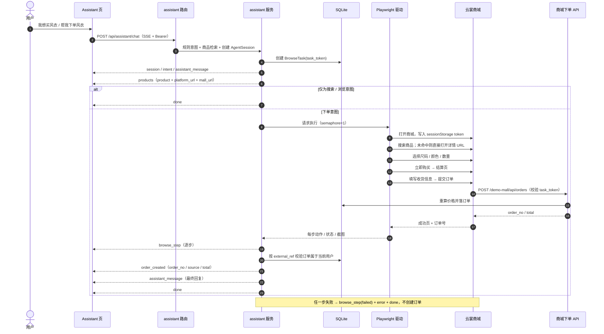

# 浏览器自动化与云裳商城

> 本文说明单智能体如何通过 Playwright 真实驱动内置模拟商城「云裳商城」，完成搜索、选规格、结算与下单；同时给出稳定选择器、截图位置、SSE 事件、失败边界与测试方式。
>
> 云裳商城是课程演示用的**本地模拟商城**，不接真实电商、不登录真实账号、不进行真实支付。
> 本文已按 2026-11-21 的实际代码与 T17 验收结果更新。最近一次真实浏览器验证：Microsoft Edge 157.0.4341.60 无头，7 个步骤全部完成，订单 `YJ202611212346510445`，`source=agent`。详见 `docs/E2E_RESULTS.md`。

## 1. 组件与职责

| 组件 | 路径 | 职责 |
|---|---|---|
| 前端购物助理页 | `frontend/src/pages/Assistant.tsx` | 聊天输入、SSE 渲染、商品链接卡、工具时间线、截图灯箱 |
| 助理路由 | `backend/app/routers/assistant.py` | `POST /api/assistant/chat`（SSE）、会话查询、历史 |
| 助理服务 | `backend/app/services/assistant.py` | 意图识别、商品检索、创建任务、调用浏览器、校验并落订单 |
| Playwright 驱动 | `backend/app/browser/playwright_driver.py` | 浏览器启动 / 关闭、Edge → Chromium 回退、并发信号量、截图 |
| 商城操作器 | `backend/app/browser/shopper.py` | 搜索、详情、选规格、结算、提交、读订单号 |
| 可选 browser-use 引擎 | `backend/app/browser/browser_use_driver.py` | `BROWSER_ENGINE=browser_use` 时用 browser-use 1.x 自然语言 Agent 驱动本地浏览器；可选依赖，需 LLM Key |
| 测试引擎 | `backend/app/browser/mock_driver.py` | 仅在测试或 `BROWSER_ENGINE=mock` 时使用；不启动浏览器，不产生截图，但通过同一订单服务真实落库 |
| 订单服务 | `backend/app/browser/order_service.py` | 令牌 / 商品 / 规格 / 库存校验、服务端重算价格、幂等落单 |
| 商城路由 | `backend/app/routers/demo_mall.py` | 商品查询、下单 API、`task_token` 校验 |
| 商城页面 | `backend/app/demo_mall/` | 原生 HTML/CSS/JS，独立视觉 |
| 任务模型 | `backend/app/models.py::BrowseTask` | 任务令牌、步骤、状态、订单号、错误 |

边界：

- 浏览器只访问本地 FastAPI 提供的 `/demo-mall/*` 页面，不访问外部电商站点。
- 商城结算为模拟支付，不生成真实交易。
- 浏览器不可用或任一步失败时，必须通过 SSE `error` 返回中文提示，**绝不伪造“下单成功”**。
- 截图属于运行期文件，写入 `backend/runtime/screenshots/`，不写入 `app/`，避免 uvicorn 热重载。
- 默认 Playwright 引擎已实测；可选 browser-use 适配器已实现但**未在当前机器实测**（未安装可选包、无 DashScope Key）。缺少可选包或 Key 时明确报错，或按配置回退 Playwright，绝不伪造成功。

## 2. 云裳商城

### 2.1 页面

| 路径 | 说明 |
|---|---|
| `/demo-mall/` | 商城首页，搜索框与商品卡列表 |
| `/demo-mall/product.html?id=<id>` | 商品详情，尺码 / 颜色 / 数量、立即购买 |
| `/demo-mall/checkout.html` | 结算页，收货人、手机号、地址、提交订单 |
| `/demo-mall/success.html?order_no=<order_no>` | 成功页，展示订单号与合计 |

商城使用原生 HTML/CSS/JS，视觉与主站刻意区分，模拟“外部商城”。商品数据来自同一商品库的子集，价格与服务端一致。页面明确标注「云裳商城 · 模拟商城」「模拟支付」。

### 2.2 API

| 方法 | 路径 | 说明 |
|---|---|---|
| GET | `/demo-mall/api/products?q=` | 商城商品列表，支持关键词；最多返回 48 件 |
| GET | `/demo-mall/api/products/{id}` | 商品详情；不存在时中文 404 |
| POST | `/demo-mall/api/orders` | 提交订单，校验 `task_token`，服务端重算价格；同一令牌幂等 |

### 2.3 下单入参

```json
{
  "task_token": "由 BrowseTask 生成的令牌",
  "product_id": 1,
  "size": "M",
  "color": "雾灰",
  "quantity": 1,
  "customer": {
    "name": "云裳体验官",
    "phone": "13800000000",
    "address": "上海市黄浦区云裳路 88 号 衣见公寓 3 栋 501（演示地址）"
  }
}
```

成功响应：

```json
{
  "order_no": "YJ202611212346510445",
  "total": 1299.0,
  "status": "paid",
  "idempotent": false
}
```

服务端职责（`order_service.create_agent_order`）：

1. 校验 `task_token` 存在、对应 `BrowseTask` 未失败；无效时返回中文 4xx。
2. 校验任务所属 `AgentSession` 有登录用户；匿名不能创建 agent 订单。
3. 根据 `product_id`、`quantity` 与商品库重新计算金额，**不信任前端传入的任何金额**。
4. 校验商品存在、有库存、尺码 / 颜色可用、数量在 1–10 之间；失败返回中文错误。
5. 创建平台订单：`source="agent"`、`external_ref=order_no`、`status="paid"`（模拟支付）。
6. 更新 `BrowseTask.status`、`steps` 与 `order_no`；返回订单号与总价。
7. 同一 `task_token` 重复提交时返回原订单（`idempotent=true`），不重复扣减或生成新订单。

`external_ref` 在 `orders` 表中唯一，避免同一商城订单号重复落库。

## 3. 端到端流程



### 3.1 详细步骤

1. **意图识别**：规则优先识别「买 / 下单 / 搜索」与关键词；规则不命中时用 Qwen 结构化解析兜底。下单意图要求已登录。
2. **商品检索**：按关键词查询商品库，生成两类链接：
   - 平台商品页：`/product/<id>`
   - 云裳商城商品页：`/demo-mall/product.html?id=<id>`
3. **创建任务**：建立 `AgentSession(kind="assistant")` 与 `BrowseTask(task_token)`，记录会话、状态与步骤。
4. **SSE 推送**：`session` → `intent` → `assistant_message` → `products`。
5. **启动浏览器**：Playwright 先尝试 Edge `msedge` 无头模式；失败后尝试内置 Chromium。视口 1280×900，语言 `zh-CN`，操作超时 15 秒、导航超时 25 秒；全局并发信号量 1。
6. **打开商城并写入令牌**：访问 `/demo-mall/`，等待 `[data-testid="mall-search"]`，把 `task_token` 写入当前页面 `sessionStorage["mall_task_token"]`；结算页从同一标签页的 sessionStorage 读取令牌。
7. **搜索与详情**：在 `[data-testid="mall-search"]` 输入关键词并回车；等待 `[data-testid="mall-product-card"][data-product-id="<id>"]`。若搜索结果未命中，直接打开 `/demo-mall/product.html?id=<id>&token=<task_token>`。
8. **选择规格**：优先点击 `button[data-size="<尺码>"]`、`button[data-color="<颜色>"]`；不存在时回退到第一个可选按钮；填写 `#mall-qty`；截图。
9. **结算**：点击 `[data-testid="mall-buy-now"]`，等待 `/checkout.html` 与 `[data-testid="mall-place-order"]`；填写 `#ship-name`、`#ship-phone`、`#ship-address`（默认演示收货信息，不使用真实个人信息）。
10. **提交**：点击 `[data-testid="mall-place-order"]`，等待 `/success.html` 与 `[data-testid="mall-order-no"]`，用正则提取 `YJ` 订单号；从 `[data-testid="mall-order-total"]` 读取合计；截图。
11. **落库与校验**：商城订单 API 返回订单号后，助理服务执行 `_verify_order(order_no, user_id)`，确认平台 `Order` 存在且属于当前用户，才发送 `order_created`。
12. **通知前端**：推送 `order_created`、最终 `assistant_message` 与 `done`；前端在 `/orders` 可查询到该订单。

每一步都会产生 `browse_step`：`{index, action, status, detail, screenshot}`。前端工具时间线按 `index` 排序展示，可点开截图灯箱。实际 7 个步骤为：打开云裳商城 → 搜索并进入商品详情 → 选择尺码与颜色 → 进入结算页 → 填写收货信息 → 提交订单 → 下单成功。

## 4. 稳定选择器（契约）

以下选择器是商城页面与 Playwright 的共同契约，修改任一处都必须同步更新页面、驱动与本文档：

| 选择器 | 所在页面 | 用途 |
|---|---|---|
| `[data-testid="mall-search"]` | 商城首页 | 搜索输入框 |
| `[data-testid="mall-product-card"]` | 商城首页 | 商品卡容器（同时带 `data-product-id`） |
| `[data-testid="mall-product-name"]` | 商城首页 / 商品卡 / 详情页 | 商品名称 |
| `[data-testid="mall-buy-now"]` | 商品详情页 | 立即购买按钮 |
| `#mall-qty` | 商品详情页 | 购买数量 |
| `button[data-size]` | 商品详情页 | 尺码按钮 |
| `button[data-color]` | 商品详情页 | 颜色按钮 |
| `#ship-name` | 结算页 | 收货人姓名 |
| `#ship-phone` | 结算页 | 收货人手机号 |
| `#ship-address` | 结算页 | 收货地址 |
| `[data-testid="mall-place-order"]` | 结算页 | 提交订单按钮 |
| `[data-testid="mall-order-no"]` | 成功页 | 订单号展示元素 |
| `[data-testid="mall-order-total"]` | 成功页 | 订单合计 |

选择器使用原则：

- 优先 `data-testid`，避免依赖视觉样式、位置、文本或 CSS 类名。
- 表单字段使用稳定 `id`（`#ship-name` 等）。
- 商品卡匹配使用 `data-product-id`，避免同名商品或排序变化导致点错。
- 不在测试中写容易变化的完整 DOM 路径。
- 若必须新增选择器，先更新契约与商城页面，再更新驱动，避免“测试能过但演示失败”。

## 5. 配置与启动

| 环境变量 | 默认值 | 说明 |
|---|---|---|
| `BROWSER_ENGINE` | `playwright` | `playwright`（默认，真实 Edge/Chromium）或 `mock`（仅测试）；可选 `browser_use` |
| `BROWSER_HEADLESS` | `true` | 调试时可设 `false` 观察浏览器 |
| `PLAYWRIGHT_CHANNEL` | `msedge` | 优先使用本机 Edge；置空或 Edge 启动失败时尝试 Playwright 内置 Chromium |
| `BROWSER_USE_MODEL` | 空 | browser-use 使用的文本模型；空则用 `QWEN_TEXT_MODEL`（默认 `qwen-plus`） |
| `BROWSER_USE_MAX_STEPS` | `40` | browser-use Agent 最大步数 |
| `BROWSER_USE_TIMEOUT` | `240` | browser-use Agent 总超时（秒） |
| `BROWSER_USE_EXECUTABLE_PATH` | 空 | 本地浏览器路径；空则自动找 Edge/Chrome |
| `BROWSER_USE_FALLBACK_TO_PLAYWRIGHT` | `false` | 缺少可选包/Key 时是否自动回退 Playwright |

启用可选 browser-use 引擎：

```bash
cd C:/Users/cc/Desktop/服装平台项目
backend/.venv/Scripts/python.exe -m pip install -r backend/requirements-optional.txt
# backend/.env:
# DASHSCOPE_API_KEY=sk-...
# BROWSER_ENGINE=browser_use
# BROWSER_USE_FALLBACK_TO_PLAYWRIGHT=false
```

browser-use 1.0 的 `Agent` 会用 LLM 决定操作步骤，结果、成本和步数具有非确定性；课堂演示默认仍建议 Playwright。browser-use 1.0 不提供逐步截图，适配器会输出动作步骤，并在运行结束后从 `BrowseTask` 读取商城订单号；需要逐步截图时使用默认 Playwright 引擎。

固定参数（由驱动实现，非环境变量）：

- 视口：1280×900；语言：`zh-CN`。
- 操作超时：15 秒；导航超时：25 秒。
- 并发：`asyncio.Semaphore(1)`；同一时刻只允许一个浏览器下单任务。
- 浏览器在任务结束时关闭；应用 lifespan 关闭时兜底关闭残留浏览器。

无 Edge 时安装 Playwright Chromium：

```bash
cd C:/Users/cc/Desktop/服装平台项目/backend
.venv/Scripts/python.exe -m playwright install chromium
```

或使用环境脚本：

```bash
cd C:/Users/cc/Desktop/服装平台项目
bash scripts/setup.sh --with-browser
# PowerShell: powershell -ExecutionPolicy Bypass -File scripts\setup.ps1 -WithBrowser
```

驱动启动顺序：

1. `chromium.launch(channel="msedge", headless=True)`。
2. 若 Edge 失败，`chromium.launch(headless=True)`（需要事先安装内置 Chromium）。
3. 两者都失败，抛 `BrowserUnavailable`，附带中文排查提示。

## 6. 截图

### 6.1 位置与访问

- 磁盘目录：`backend/runtime/screenshots/<session_id>/NN.png`
- 成功步骤：`01.png` … `07.png`；失败时尽力生成 `99-error.png`
- 访问前缀：`/screenshots/<session_id>/NN.png`
- FastAPI 挂载：`app.mount("/screenshots", StaticFiles(directory=settings.screenshots_dir))`
- 前端展示：`ToolTrace` 组件按 `browse_step.index` 显示缩略图，点击打开灯箱。

为什么放在 `runtime/` 而不是 `app/static/`：

- uvicorn 以 `--reload-dir app` 监听应用目录；截图写入 `app/` 会触发热重载，导致演示中断。
- 运行期文件与源码分离，便于清理和 git 忽略。

截图失败不会中断下单流程：`PlaywrightDriver.screenshot()` 捕获异常并返回空字符串，`browse_step.screenshot` 为 `null`；订单真实性仍以成功页订单号与平台落库为准。

### 6.2 实测截图

T17 真实浏览器轨迹已归档（1280×900）：

- `docs/screenshots/t17/assistant-order/01.png`：打开云裳商城
- `docs/screenshots/t17/assistant-order/02.png`：搜索并进入商品详情
- `docs/screenshots/t17/assistant-order/03.png`：选择尺码与颜色
- `docs/screenshots/t17/assistant-order/04.png`：进入结算页
- `docs/screenshots/t17/assistant-order/05.png`：填写收货信息
- `docs/screenshots/t17/assistant-order/06.png`：提交订单
- `docs/screenshots/t17/assistant-order/07.png`：下单成功
- `docs/screenshots/t17/assistant-order-success.png`：成功页单图

另有一组较早归档：`docs/screenshots/assistant-order-trace/01.png … 07.png`。

失败时保留最后一步截图，并尽力生成 `99-error.png` 便于定位；截图目录已被 `.gitignore` 忽略，可在演示前手动清理旧会话。

## 7. SSE 事件

`POST /api/assistant/chat` 返回 `text/event-stream`，事件：

| event | data | 说明 |
|---|---|---|
| `session` | `{session_id, kind, mode, engine}` | 建立会话；`engine` 为 `playwright` 或 `mock` |
| `intent` | `{intent, query, size, color, confidence}` | 搜索 / 购买 / 下单意图 |
| `assistant_message` | `{role, content}` | 助理回复 |
| `products` | `{items:[{product, platform_url, mall_url}]}` | 商品链接卡 |
| `browse_step` | `{index, action, status, detail, screenshot}` | 浏览器步骤与截图 URL |
| `order_created` | `{order_no, source, total, session_id}` | 只在成功拿到订单号且平台订单校验通过后发送 |
| `warning` | `{code, message, stage?}` | 非终止提示（如 `variant_adjusted`、`no_product`、`qwen_fallback`） |
| `error` | `{code, message}` | 终止错误（如 `browser_unavailable`、`assistant_error`） |
| `done` | `{session_id, elapsed_ms, status}` | 正常或失败流程结束；失败时 `status="failed"` |

实际顺序：

- 下单成功：`session` → `intent` → `assistant_message` → `products` → `browse_step` × 7 → `order_created` → `assistant_message`（最终回复）→ `done`
- 下单失败：`...` → `browse_step`（最后一步 `status="failed"`）→ `error` → `done`（`status="failed"`）

前端要求：

- 使用 `lib/sse.ts` 的 `postSSE`，携带 Bearer token；不要用 `EventSource`。
- 只有收到 `order_created` 才展示“下单成功”和订单号；`browse_step` 的中间状态不能当作成功。
- 收到 `error` 时展示中文错误与重试入口；保留已收到的步骤与截图。
- 用户取消（`AbortController`）不视为错误，但后端仍尽量记录已完成步骤。

## 8. 失败与降级

| 情况 | 行为 | 是否创建订单 |
|---|---|---|
| Playwright 未安装 / 浏览器启动失败 | SSE `error`（`browser_unavailable`），中文提示检查 Edge / Chromium | 否 |
| 页面超时、元素找不到 | 记录失败步骤与 `99-error.png`，SSE `error` 中文提示 | 否 |
| 商城搜索无结果 | 驱动直接打开目标商品详情 URL；若仍失败则 `error` | 否 |
| `task_token` 无效 / 过期 | 商城 API 返回中文 4xx；助理转 `error` | 否 |
| 规格或库存校验失败 | 商城 API / 订单服务返回中文错误 | 否 |
| 提交后未出现成功页 | 视为失败，保留截图，不读假订单号 | 否 |
| 商城显示成功但平台未落库 | `_verify_order` 失败，SSE `error`，不发送 `order_created` | 否（平台侧） |
| 截图失败 | 步骤继续，`screenshot=null` | 以实际订单为准 |
| SSE 客户端断开 | 后台任务继续，尽量完成浏览器与落库；刷新后从会话历史回看 | 以实际完成为准 |

原则：

- **失败就是失败**：没有拿到商城成功页与订单号，绝不发送 `order_created`。
- **双重确认**：即使商城成功页显示订单号，平台数据库查不到该用户订单也不报成功。
- **可诊断**：每个失败步骤都带 `detail` 与截图。
- **可重试**：用户可重新发起对话；不复用失效 `task_token`。
- **不信任前端**：金额、规格、订单号以服务端与商城页面为准。

## 9. 测试与 Mock 引擎

### 9.1 默认 pytest（无真实浏览器）

- 默认 `pytest` 会把 `settings.browser_engine` 临时设为 `mock`；`MockMallShopper` 不启动浏览器、不产生截图，但通过同一个 `order_service.create_agent_order` 真实写 `Order/OrderItem/BrowseTask`。
- 因此默认测试可以在无 Edge / 无 Chromium 环境运行，覆盖 assistant SSE、订单落库与失败不造假。
- 本次实测：`cd backend && .venv/Scripts/python.exe -m pytest` → **79 passed, 26.83s**。
- 仓库当前**没有** `RUN_BROWSER_TESTS` 这个 pytest 开关。

```bash
cd C:/Users/cc/Desktop/服装平台项目/backend
.venv/Scripts/python.exe -m pytest
```

### 9.2 可选真实浏览器 E2E

`scripts/e2e_browser_test.py` 默认打印说明后以 0 退出，不启动浏览器；加 `--browser` 才执行真实流程。它要求后端已运行，并通过本地数据库创建合法的 `BrowseTask` 令牌（与被测后端同机同一 SQLite；可用 `--task-token` 覆盖）。

```bash
cd C:/Users/cc/Desktop/服装平台项目

# 默认跳过
backend/.venv/Scripts/python.exe scripts/e2e_browser_test.py

# 真实浏览器（Edge 无头）
backend/.venv/Scripts/python.exe scripts/e2e_browser_test.py --browser

# 可见窗口，便于演示
backend/.venv/Scripts/python.exe scripts/e2e_browser_test.py --browser --headed
```

### 9.3 无 Key 全链路 E2E

`scripts/e2e_full_mock.py` 需要后端已在 `127.0.0.1:8000` 运行，并使用 `demo/demo123`；它会走完注册、商品、购物车、平台订单、小模型、五智能体、助理商品卡与真实浏览器下单，并把截图复制到 `docs/screenshots/t17/`。

```bash
cd C:/Users/cc/Desktop/服装平台项目
backend/.venv/Scripts/python.exe scripts/e2e_full_mock.py
```

T17 实测：10/10 通过；真实 Edge 完成 7 个步骤，订单 `YJ202611212346510445`，`source=agent`，可查 `/api/orders`。该脚本会清空 demo 购物车并留下测试数据。

### 9.4 HTTP 冒烟

`scripts/smoke_test.py` 只走 HTTP API（其中包括商城商品接口），不执行浏览器下单；浏览器真实链路以 9.2 / 9.3 为准。

```bash
cd C:/Users/cc/Desktop/服装平台项目
backend/.venv/Scripts/python.exe scripts/smoke_test.py
```

## 10. 手动验收

1. 启动后端与前端（见 README）。
2. 登录 `demo / demo123`。
3. 进入 `/assistant`，输入「我想买风衣」，确认商品链接卡同时包含平台链接与商城链接。
4. 输入「帮我下单风衣」（或点击建议词「帮我下单暮色长风衣，M 码」），观察步骤时间线：
   - 打开云裳商城 → 搜索并进入商品详情 → 选择尺码与颜色 → 进入结算页 → 填写收货信息 → 提交订单 → 下单成功。
   - 每一步有截图，截图 URL 以 `/screenshots/` 开头。
5. 成功提示中的订单号与商城成功页一致。
6. 打开 `/orders`，确认新订单：
   - `source=agent`
   - 金额与商城一致
   - 商品、尺码、颜色、数量正确
7. 直接检查商城 API：

```bash
curl -s --get --data-urlencode "q=风衣" http://127.0.0.1:8000/demo-mall/api/products
```

8. 检查截图目录：

```bash
ls -la C:/Users/cc/Desktop/服装平台项目/backend/runtime/screenshots
```

## 11. 可选引擎与扩展说明

- **browser-use 适配器已实现**：`backend/app/browser/browser_use_driver.py` 使用 browser-use 1.x 的 `Agent` + `ChatOpenAI`（DashScope 兼容接口）+ 本地 `Browser('chromium')`；通过 `BROWSER_ENGINE=browser_use` 启用，依赖 `requirements-optional.txt`。
- **未在本机实测**：当前环境未安装 browser-use 可选包、无 `DASHSCOPE_API_KEY`，所以真实 Agent 执行没有验证；已验证缺依赖/缺 Key 时会抛出中文 `BrowserUnavailable`，不会伪造订单。
- browser-use 1.0 的 `AgentHistoryList` 不提供逐步截图；适配器输出动作步骤，订单号从 `BrowseTask` 数据库读取。默认 Playwright 引擎仍负责完整截图演示。
- 若后续需要多浏览器并发，需要重新评估 `asyncio.Semaphore(1)` 与 SQLite 写锁；当前定位仍是单机演示。

## 12. 安全与合规

- 云裳商城是内置模拟商城；页面、商品、订单、支付均为课程演示数据。
- 不登录真实电商平台、不抓取真实商品数据、不进行真实支付、不填写真实个人信息。
- `task_token` 由服务端生成并绑定任务；商城下单必须校验，防止任意调用创建订单。
- 金额由服务端重算；前端传入的价格不参与结算。
- 截图可能包含演示收货信息，均为虚构；运行期目录已被 git 忽略。
- 不在日志、截图或文档中输出任何 API Key。
- `JWT_SECRET` 默认值仅用于开发；部署前必须更换。

## 13. 文档状态与已知问题

- 本文与 README、架构文档、演示脚本同批于 T18（2026-11-21）按实际代码更新。
- 本机浏览器环境：未安装 Playwright 内置 Chromium；实际使用系统 Microsoft Edge 157.0.4341.60。若 Edge 不可用，下单会以中文 `BrowserUnavailable` 明确失败，不会伪造成功；可执行 `playwright install chromium` 补齐。
- T17 在演示库留下了测试账号、demo 用户的两笔订单、荐衣 / 助理会话与浏览任务；`e2e_full_mock.py` 还会清空 demo 购物车。T18 文档验收复跑冒烟脚本又留下一个一次性账号与一笔已取消订单。需要干净数据时删除 `backend/data/app.db` 后重启。
- 真实浏览器 E2E 依赖同机后端与本地 SQLite；`scripts/e2e_full_mock.py` 不会自行启动 / 停止服务，也不访问外部网络。
